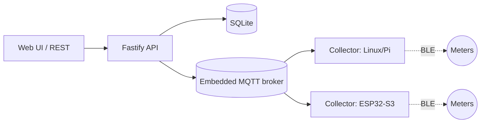

# YunMu Hub

Central controller for YunMu BLE power-meter collectors. Collectors run on the
edge (Raspberry Pi first, ESP32-S3 later) and dial **out** to the hub over
MQTT; the hub owns naming, bindings, scan sessions, learning jobs and health.

`hub/` is the **central controller** (server + web UI + collector simulator).
The BLE protocol, Pi collector and Rust edge collector live in the repository
root (`yunmu_ble_meter/`, `rust/`, `docs/`).

## Architecture



- **Thin agent, fat controller**: collectors only know MAC + payload/xor +
  sampling profile. Names, SN, location, grouping live in the hub.
- **Desired state**: the hub publishes the full device list per collector
  (retained, epoch-tagged); the collector reconciles and reports back.
- **Jobs**: scan sessions and learning jobs are state machines, not one-shot
  commands. Learning requires exclusive access to the meter.
- **Outbound only**: collectors connect to MQTT over TLS; no inbound ports.

## Packages

| Package | Purpose |
|---|---|
| `packages/protocol` | Zod schemas + MQTT topics shared by server, agents, simulator |
| `packages/server` | Fastify API, embedded Aedes broker, SQLite store, SSE |
| `packages/web` | React + Vite + Tailwind + shadcn/ui console |
| `packages/simulator` | Fake collectors/meters for development without hardware |

## Quickstart

Requirements: [Bun](https://bun.sh) 1.3+ (runtime, package manager, `bun:sqlite`, `bun test`).

```bash
bun install
bun run build

# terminal 1 — hub (HTTP :8080, MQTT :1883, SQLite under packages/server/data)
bun run --filter @yunmu/server start

# terminal 2 — one simulated collector with fake meters
bun run --filter @yunmu/simulator start
```

Open <http://127.0.0.1:8080>. The server serves `packages/web/dist`; for UI
development run `bun run --filter @yunmu/web dev` (Vite proxies `/api` to :8080).

Demo flow:

1. 设备 → 录入设备（MAC + payload/xor）→ 绑定到 `sim-01`；
2. 几秒内出现电压/功率；`学习` 会下发一个学习作业并写回 payload/xor；
3. 扫描 → 开始扫描 → 模拟器上报 sightings → 可直接录入；
4. 概览页显示在线采集器、异常设备与最近事件。

## Hub API (MVP)

| Method | Path | Purpose |
|---|---|---|
| GET | `/api/collectors` | collector list + capabilities/status |
| GET | `/api/devices` | devices with latest values and staleness |
| POST | `/api/devices` | register by MAC (payload/xor optional) |
| PATCH | `/api/devices/:id` | rename / disable |
| POST | `/api/devices/:id/bind` | bind to a collector (capacity checked) |
| DELETE | `/api/devices/:id/bind` | unbind |
| POST | `/api/devices/:id/learn` | dispatch a learn job |
| POST | `/api/scan-sessions` | start a scan session |
| GET | `/api/scan-sessions/:id` | session + sightings |
| GET | `/api/jobs`, `/api/events` | audit/state |
| GET | `/api/stream` | SSE events for the UI |

## Storage

SQLite (`node:sqlite`, WAL) for the MVP: zero external services, easy backup.
The schema is portable; move to PostgreSQL/TimescaleDB when telemetry volume or
HA requires it. Telemetry is currently stored per sample for the latest-value
queries; add retention/downsampling before long-term production use.

## Security / MVP limits

- No authentication yet: bind to a trusted LAN, do not expose :8080/:1883.
- MQTT is plaintext in this MVP; production must use TLS + per-collector
  credentials (register token → client certificate/password).
- Collector capacity (`maxLinks`, `maxReadsPerSecond`) is enforced for bindings
  but radio admission control is still coarse.
- ESP32-S3 agent is a planned second implementation; the protocol is
  platform-neutral.

See [`docs/protocol.md`](docs/protocol.md) for the wire contract.
